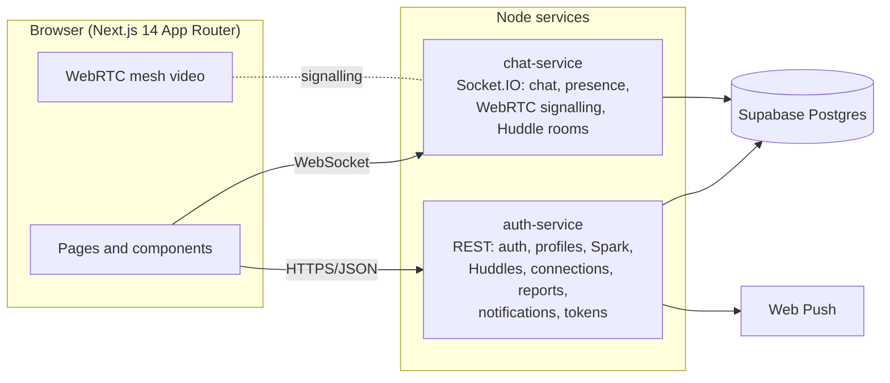

<div align="center">


# Rendly

### Know your why. Find your who.

**Intent-based social networking.** Say why you want to meet people, and Rendly connects you with the ones who want the same thing: 1:1 on Spark, in private Whispers, and live in group Huddles.

[**Live app**](https://anoryxtechsolutions.com/rendly.app) · [**Anoryx**](https://anoryxtechsolutions.com) · [Deploy guide](DEPLOY.md) · [Product spec](RENDLY_COMPLETE_PRODUCT_SPEC.md) · [System design](Rendly_System_Design.md)


</div>

---

## Contents

- [What Rendly does](#what-rendly-does)
- [Architecture](#architecture)
- [Repository layout](#repository-layout)
- [Quick start](#quick-start)
- [Configuration](#configuration)
- [Testing and quality](#testing-and-quality)
- [SEO, GEO and AEO](#seo-geo-and-aeo)
- [Deployment](#deployment)
- [Documentation](#documentation)

## What Rendly does

| Feature | What you get |
|---|---|
| **Intents** | A profile built around *why* you are here: find a co-founder, collaborate, learn, make friends, with location-aware intents (city, country, nearby). |
| **Spark** | Pick one or more intents and get matched 1:1 with someone who shares one. Matches open a room with video and chat. Stay anonymous until you choose to connect. Each match costs tokens; a default match is guaranteed when nobody shares your intent. |
| **Near By** | A live map of people around you who share an intent. |
| **Whispers** | Private 1:1 and group chat with your connections, with calls. |
| **Huddles** | Live group video rooms. Waiting room with **Admit all**, breakout rooms (up to 12 each) with a **leader** per room, host-appointed **admins**, a private **Admin room**, scoped mute and screen-share permissions, and in-browser **recording**. |
| **Connections & calls** | Everyone you met, with call history and one-tap call back. |
| **Tokens & rewards** | Earned by taking part, spent on Spark and on rewards inside Huddles. |
| **Safety** | Reports, blocking, moderation tools and an admin console. |
| **Push notifications** | Web push for matches, messages and Huddle reminders. |

Responsive on phones and tablets in both orientations, laptops and large screens.

## Architecture



- **auth-service** holds the business logic behind a REST API, with JWT auth and rate limiting.
- **chat-service** carries everything real-time: messages, presence, call and Huddle signalling, breakout-room state.
- **Video** is peer-to-peer WebRTC; the server only relays signalling.
- The other services under `backend/services/` are health-check stubs reserved for the post-MVP split.

## Repository layout

```text
.
├── rendly-mvp/
│   ├── frontend/                  Next.js 14 app (TypeScript, Tailwind, Jest)
│   │   ├── app/                   Routes, metadata, sitemap, robots, manifest, OG image
│   │   ├── components/            Feature UI (spark, huddles, chat, shell, landing…)
│   │   ├── hooks/ lib/ services/  State, helpers and typed API clients
│   │   └── public/                Brand, media, llms.txt, service worker
│   ├── backend/
│   │   ├── services/auth-service  REST API (Express)
│   │   ├── services/chat-service  Socket.IO real-time server
│   │   ├── shared/                Shared types and utilities
│   │   └── supabase/migrations/   SQL migrations
│   └── scripts/                   Dev tooling
├── render.yaml                    Render blueprint (backend)
├── DEPLOY.md                      Step-by-step production deploy
└── *.md                           Product spec, system design, architecture docs
```

## Quick start

**Requirements:** Node 22+, npm 10+, a Supabase project.

```bash
git clone https://github.com/TeamAnoryx/Rendly.git
cd Rendly/rendly-mvp
```

**1. Backend**

```bash
cd backend
cp .env.example .env          # fill in Supabase, JWT and OAuth values
npm run install:services
npm run dev                   # starts all services in the background
npm run status                # checks every /health endpoint
```

**2. Database:** apply the SQL files in `backend/supabase/migrations/` in order (Supabase SQL editor or `supabase db push`). See [`rendly-mvp/CLOUD.md`](rendly-mvp/CLOUD.md).

**3. Frontend**

```bash
cd ../frontend
npm install
npm run dev                   # http://localhost:3001
```

## Configuration

Frontend variables (set in Vercel for production; `NEXT_PUBLIC_*` values are baked in at build time):

| Variable | Purpose | Example |
|---|---|---|
| `NEXT_PUBLIC_API_URL` | auth-service base URL | `https://rendly-auth.onrender.com` |
| `NEXT_PUBLIC_CHAT_API_URL` | chat-service base URL | `https://rendly-chat.onrender.com` |
| `NEXT_PUBLIC_CCS_WS_URL` | Socket.IO URL (optional) | `wss://rendly-chat.onrender.com` |
| `NEXT_PUBLIC_SITE_URL` | Canonical public URL | `https://anoryxtechsolutions.com/rendly.app` |
| `NEXT_PUBLIC_ANORYX_URL` | Parent Anoryx site | `https://anoryxtechsolutions.com` |
| `NEXT_BASE_PATH` | Serve under a sub-path | `/rendly.app` (leave empty for a root domain) |
| `NEXT_PUBLIC_GITHUB_CLIENT_ID`, `NEXT_PUBLIC_LINKEDIN_CLIENT_ID`, `NEXT_PUBLIC_OAUTH_REDIRECT_URI` | OAuth sign-in | |

Backend variables are listed in [`DEPLOY.md`](DEPLOY.md) and `render.yaml`. Secrets are never committed.

## Testing and quality

```bash
# frontend
cd rendly-mvp/frontend
npx jest --ci --watchAll=false   # unit and component tests
npx tsc --noEmit -p .            # type check
npx next build                   # production build

# backend
cd rendly-mvp/backend
npm test                         # auth-service
cd services/chat-service && npm test
```

Production hardening: security headers (`nosniff`, `Referrer-Policy`, frame and permissions policies), `noindex` on signed-in areas, rate-limited API, year-long caching for static media, and server-side checks for every Huddle role action.

## SEO, GEO and AEO

| Layer | Implementation |
|---|---|
| **Metadata** | Title template, descriptions, keywords, canonical URLs, Open Graph and Twitter cards (`app/layout.tsx`, `lib/site.ts`) |
| **Share image** | Generated 1200×630 Open Graph card (`app/opengraph-image.tsx`) |
| **Crawling** | `sitemap.xml` of public pages, `robots.txt` that keeps private areas out, `X-Robots-Tag: noindex` on signed-in routes |
| **Structured data** | JSON-LD graph: `Organization` (Anoryx), `WebSite`, `SoftwareApplication`, `FAQPage` (`components/seo/JsonLd.tsx`) |
| **AEO** | FAQ answers written as direct, quotable responses and exposed as `FAQPage` |
| **GEO** | `public/llms.txt`, a plain-language summary for AI answer engines; AI crawlers allowed on public pages |
| **Installable** | Web app manifest (`app/manifest.ts`) |
| **Pagination** | In-app lists (Huddles, connections, chat) are behind sign-in and load incrementally; they are excluded from indexing, so the public sitemap holds only canonical, unpaginated pages |

Rendly is served at `anoryxtechsolutions.com/rendly.app`. The Anoryx site links to it and lists its sitemap in the domain's root `robots.txt`.

## Deployment

| Part | Platform |
|---|---|
| Frontend | Vercel (root directory `rendly-mvp/frontend`) |
| auth-service, chat-service | Render (`render.yaml` blueprint) |
| Database | Supabase |

Full walkthrough: **[DEPLOY.md](DEPLOY.md)**.

> chat-service keeps live room state in memory: run **one** instance, on a plan that does not sleep.

## Documentation

| Document | Covers |
|---|---|
| [RENDLY_COMPLETE_PRODUCT_SPEC.md](RENDLY_COMPLETE_PRODUCT_SPEC.md) | Product requirements (MVP scope FR1–FR10, NFR1–NFR6) |
| [Rendly_System_Design.md](Rendly_System_Design.md) | System design |
| [rendly_frontend_architecture.md](rendly_frontend_architecture.md) | Frontend architecture |
| [rendly_devops_infrastructure.md](rendly_devops_infrastructure.md) | DevOps and infrastructure |
| [RENDLY_MULTI_AGENT_AI_BACKEND_ARCHITECTURE.md](RENDLY_MULTI_AGENT_AI_BACKEND_ARCHITECTURE.md) | Post-MVP AI backend |
| [RENDLY_DOCUMENTATION_INDEX.md](RENDLY_DOCUMENTATION_INDEX.md) | Index of every document |

---

<div align="center">

Built by **[Anoryx Tech Solutions](https://anoryxtechsolutions.com)** · © 2026 Anoryx. All rights reserved.

</div>
